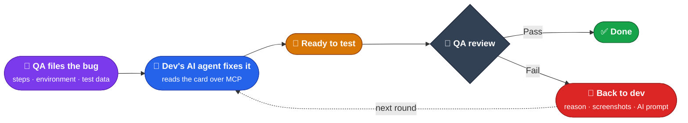

# Bugboard

[](LICENSE)
[](package.json)
[](https://m8ven.ai/mcp/pauloemmanuel/bugboard?s=readme)

**QA points out the bug, the dev fixes it right there, QA signs it off. One board, no ticket ping-pong.**

Bugboard is a **local bug board** with Excel-like **sheet tabs**, built for teams that code with AI agents. QA files a defect as a card. The developer's AI agent reads that card over **MCP**, fixes the code, and moves it to test. QA clicks **Pass** or **Fail** in the browser. Nothing gets copied between Jira, spreadsheets and chat.

*PT: o QA aponta o defeito, o dev já desenvolve direto no card pelo agente de IA (MCP), e o QA valida no navegador com Passou / Falhou.*

## How it works



1. **QA points out the defect.** One card per bug, with numbered repro steps, the environment (`where`), and the test data (`prep`).
2. **The dev fixes it from the card.** The AI agent (Claude Code, Cursor or any MCP client) reads the card, changes the code, records `fix`, `files` and `symbols`, and sets the card to `testar`.
3. **QA validates.** **Pass** closes it as `ok`. **Fail** asks for a reason (you can paste screenshots), offers a ready-made prompt to hand back to the AI, and the card returns to the dev with its `round` counter increased.

## Why Bugboard

- **The bug and the fix live on the same card.** Agents read and write it directly, so nobody re-types the bug report into a prompt.
- **Humans stay in charge of quality.** Agents can mark work as ready, but only a person clicks Pass or Fail.
- **Local first.** Data stays in SQLite on your machine. Bind the server to your LAN if a small team wants to share one board.
- **Spreadsheet feel.** Sheet tabs per project, release or device, plus status filters, repo chips and numbered steps.
- **Code aware.** Cards link to files and symbols, so you can ask which bugs touch the same code (see [Knowledge graph](#knowledge-graph)).

## Quick start

```bash
git clone https://github.com/pauloemmanuel/bugboard.git
cd bugboard
npm install
npm run build
node dist/index.js open
```

Default URL: `http://127.0.0.1:3847` (override with `BUGBOARD_PORT`).

**Global install (optional):**

```bash
npm link
bugboard open
```

CLI: `serve` | `open` | `status` | `mcp`.

## Data location

All board data lives in **`~/.bugboard/`** (SQLite). Cloning this repo does **not** copy anyone's sheets or cards. Each machine has its own database.

## Sheets

Create **sheets** (tabs) for a project, a release or a device matrix, then add cards through MCP or the HTTP API. Archived sheets are hidden from the default list (MCP: `sheet_archive`).

## Journeys and use cases

**Journey** cards (`kind: journey`, `parent_id` null) group a device or platform run (e.g. iOS release 2.3). **Use case** cards (`kind: usecase`, `parent_id` set) are atomic flows inside that journey (signup, chat, wallet). Each use case has its own status, steps, and pass/fail; one failure does not block the whole journey. Journey cards show child progress (`3/7 ok`) from use case statuses; marking a journey **Passou** does not auto-pass children.

`prep` is a string array of test data the agent should fill (emails, MFA codes, package names, URLs). The UI shows **Preparação** on use cases.

`platform` on journeys: `ios` | `android` | `web` | `ipad` (icons in the UI). Children may inherit display from the parent.

`bug_list` and `GET /api/sheets/:id/bugs` return **nested** journeys with `children[]`.

## Card schema

| Field | Type | Notes |
| --- | --- | --- |
| `title` | string | Required |
| `kind` | enum | `journey` (root) or `usecase` (child) |
| `parent_id` | string? | Parent journey id for use cases |
| `platform` | enum? | `ios`, `android`, `web`, `ipad` |
| `prep` | string[] | Test data / massa for agents to fill |
| `repos` | string[] | Repo names or paths (display only) |
| `status` | enum | See below |
| `where` | string | Environment or surface to test |
| `steps` | string[] | Repro or QA steps (one string per step) |
| `fix` | string | What changed or what to verify |
| `round` | number | Increments when a failed card returns to `testar` |
| `note` | string | Tester notes on pass/fail |
| `files` | string[] | Repo-relative paths prefixed with the repo folder, e.g. `wellmexh-frontend-react-native/app/hooks/x.ts` |
| `symbols` | string[] | Function or component names |

### Statuses

| Status | Meaning |
| --- | --- |
| `fazendo` | In progress |
| `testar` | Ready for human QA |
| `ok` | Passed |
| `falhou` | Failed |
| `cancelado` | Cancelled: the card no longer makes sense (the screen changed, or the AI got the scenario wrong). Hidden from **Todos**, shown under the **Cancelado** filter, reopen anytime |

## MCP setup

Bugboard exposes a **stdio MCP server**. Point your IDE at `dist/index.js mcp` after `npm run build`.

### Cursor

Edit `~/.cursor/mcp.json` (or project MCP config):

```json
{
  "mcpServers": {
    "bugboard": {
      "command": "node",
      "args": ["/absolute/path/to/bugboard/dist/index.js", "mcp"]
    }
  }
}
```

With a global binary after `npm link`:

```json
{
  "mcpServers": {
    "bugboard": {
      "command": "bugboard",
      "args": ["mcp"]
    }
  }
}
```

Restart Cursor after changes.

### Claude Code

One command:

```bash
claude mcp add bugboard -- node /absolute/path/to/bugboard/dist/index.js mcp
```

Or add the same block under `mcpServers` in `~/.claude.json` (or your Claude Code MCP config) and restart the CLI session.

See also [`.mcp.json`](./.mcp.json) in this repo for a working absolute-path example.

## MCP tools

| Tool | Description |
| --- | --- |
| `board_status` | Health, DB path, port, aggregate counts |
| `board_open` | Start HTTP server if needed, open browser |
| `sheet_list` | List sheets (optional `include_archived`) |
| `sheet_create` | Create a sheet tab |
| `sheet_rename` | Rename a sheet |
| `sheet_archive` | Archive a sheet |
| `bug_list` | List bugs on a sheet (optional `status` filter, `compact: true` for one line per card) |
| `bug_get` | Get one bug by id |
| `bug_create` | Create a card |
| `bug_update` | Patch fields (round auto-increment rules apply) |
| `bug_pass` | Human pass (`ok`) |
| `bug_fail` | Human fail (`falhou`) |
| `bug_cancel` | Cancel a card that no longer makes sense (`cancelado`), reason in `note` |
| `board_query` | Graphify-style BFS over the board graph (`sheet_id?`, `question`, `depth=2`, `budget=2000`) |
| `board_explain` | Neighbors of a card (`#n`/id), file or symbol, grouped by edge type |
| `board_path` | Shortest path between two cards, files or symbols |
| `board_clusters` | Card groups joined by shared code, links or similar titles, with a suggested journey each |
| `bug_link` / `bug_unlink` | Link cards: `related`, `depends_on`, `duplicate`, `regression_of`, `same_flow` |

## Knowledge graph

The board is also a graph, rebuilt in memory after every write. Nodes: sheets, journeys, use cases, repos, files, symbols. Edges: `parent`, `in_sheet`, `in_repo`, `touches_file`, `touches_symbol`, explicit links, plus inferred `shares_code` (same file or symbol) and `similar_title` (token overlap).

File nodes are matched against `<BUGBOARD_CODE_ROOT>/<repo>/graphify-out/graph.json` (default `~/Projetos/GroupLookstar`); a hit adds the graphify node id and community, so a card connects into the code graph.

Every rebuild writes `~/.bugboard/graph.json` in graphify's format, so the CLI works too:

```bash
graphify query "saque documento" --graph ~/.bugboard/graph.json
```

Env: `BUGBOARD_DATA_DIR` (default `~/.bugboard`), `BUGBOARD_CODE_ROOT`. Smoke test: `npm run build && node test/graph-smoke.mjs` (temp dirs only).

## HTTP API

The SPA uses `GET/PATCH /api/...` on the same port as the UI. Useful for scripts; agents should prefer MCP.

## Changelog

We follow [Keep a Changelog](https://keepachangelog.com/en/1.1.0/) and [Semantic Versioning](https://semver.org/). See [CHANGELOG.md](./CHANGELOG.md).

## Contributing

Issues and PRs welcome on [GitHub](https://github.com/pauloemmanuel/bugboard). Keep changes small and documented in the changelog.

## License

MIT. Copyright Paulo Emmanuel. See [LICENSE](./LICENSE).
